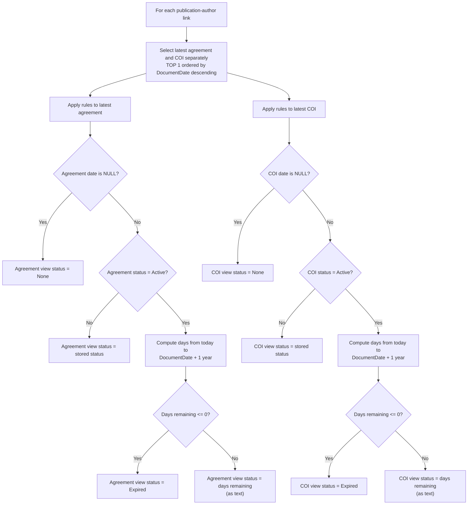

# Publication author document status

`dbo.vw_PublicationAuthorDocumentStatus` returns a row for each publication-author link. For each author, it independently selects the agreement and COI record with the greatest `DocumentDate`, then applies the same status rules to each record.

## Important details

- The selected record is scoped to the author, not the publication. Both `AuthorAgreements` and `COIs` are looked up using `AuthorID`.
- The view does not filter source documents by status or `IsDeleted`; the latest row by `DocumentDate` is considered.
- A missing document or a selected document with a `NULL` date yields `None`, regardless of its stored status.
- Only a stored status exactly equal to `Active` receives the one-year expiration calculation. Other statuses pass through unchanged.
- For an active, dated document, the expiration date is one year after `DocumentDate`. If the SQL `DATEDIFF` day count from today is zero or negative, the result is `Expired`; otherwise, the positive day count is returned as text.
- If multiple records share the latest `DocumentDate`, the view does not specify a tie-breaker.

Source: [SQL/schema.sql](SQL/schema.sql), definition of `dbo.vw_PublicationAuthorDocumentStatus`.
